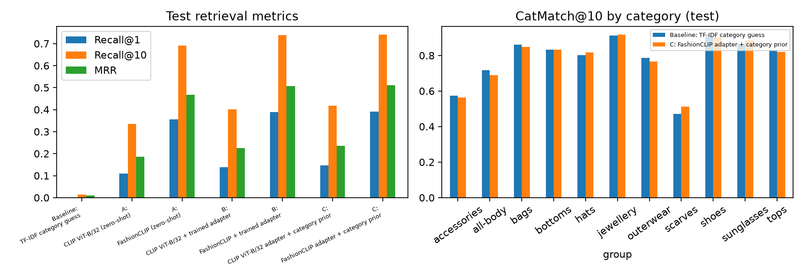

## 1. Task and data

The application needs a model takes user input e.g.("black leather ankle boots") along with preferences from the users closet and returns a ranking of items to then be used in creating an outfit. We utilized the Polyvore data set (`owj0421/polyvore`) which contains in image per item, a category (11 classes), and mostly empty `title`/`description` fields (about 70% empty). Because of the missing data in the `title`/`description` field we instead use the `url_name` field which is always present as the text prompt. In addition because of the size of the Polyvore dataset and compute restraints we used only one of six shards in the modeling process. This worked out to 41,835 rows compared to the roughly 200,000 of the full dataset.

**Evaluation task.** Each unique `url_name` is a query which is used to search through the gallery; the gallery contains the images of the split; a result is successful if it finds the image matched to the query. **Split:** 70/15/15 train/val/test, grouped by `url_name` so no prompt text appears in two splits which was verified to to ensure the integrity of the results. Val has 6,006 queries over 6,308 items, test 6,006 queries over 6,268 items. **Metrics (identical for every model):** Recall@1/5/10, MRR, and CatMatch@10 (share of the top-10 with the correct clothing category, a softer "right kind of item" score). Ties are scored at mid-rank so no model gains from tied scores. Models are selected on **val only**; test is reported once.

We chose these metrics because combined they provide a good picture of where the model stands. For example, if recall 1 is low but recall 5 is high having those two metrics combined with the others gives a good overview of changes to be made. Along with this we made sure to evaluate on the val set as opposed to test so we don't pick a model that over-fits the test score.

## 2. Models compared

| | Model | Idea |
|---|---|---|
| Baseline | TF-IDF + logistic regression | Guess the *category* from the prompt, return that category's items in random order. Never sees an image. |
| A | Zero-shot CLIP ViT-B/32; zero-shot FashionCLIP | Pretrained image and text encoders embed both in one space; rank by cosine similarity. No training. |
| B | A + trained adapter | Encoders frozen; a small residual MLP on each side trained with a contrastive loss on train pairs (identical prompts masked as false negatives), early-stopped on val MRR. |
| C | B + category prior | B's similarity plus λ·P(category \| prompt) from the baseline classifier; λ chosen on val. |

Each of A, B, C was run on two backbones (generic CLIP, fashion-specific FashionCLIP), giving six candidates.

## 3. Results

| Test set | Recall@1 | Recall@5 | Recall@10 | MRR | CatMatch@10 |
|---|---|---|---|---|---|
| Baseline: TF-IDF category guess | 0.0005 | 0.0070 | 0.0142 | 0.0092 | 0.8365 |
| A: CLIP (zero-shot) | 0.1096 | 0.2494 | 0.3347 | 0.1857 | 0.7215 |
| A: FashionCLIP (zero-shot) | 0.3556 | 0.6022 | 0.6916 | 0.4685 | 0.7840 |
| B: CLIP + adapter | 0.1380 | 0.3047 | 0.4023 | 0.2249 | 0.7400 |
| B: FashionCLIP + adapter | 0.3884 | 0.6472 | 0.7386 | 0.5068 | 0.7771 |
| C: CLIP + adapter + prior | 0.1470 | 0.3162 | 0.4182 | 0.2357 | 0.8390 |
| **C: FashionCLIP + adapter + prior** | **0.3913** | **0.6528** | **0.7408** | **0.5100** | 0.8317 |

{width=95%}

**Selected Model: C with FashionCLIP** (best validation MRR of **0.5165**, beating Model B at 0.5130 and zero-shot at 0.4717). We chose this setup for three main reasons:

1. **Domain pretraining makes the biggest difference:** FashionCLIP more than doubles generic CLIP's zero-shot MRR (**0.47 vs. 0.19**), proving that a fashion-tuned backbone is our strongest lever.
2. **The adapter provides a solid boost (with early stopping):** Adding the trained adapter improves MRR by **+0.04** across both backbones. Because performance peaks around epochs 5–6 before overfitting, early stopping is essential.
3. **The category prior prevents obvious type mistakes:** While the category prior only adds a tiny **+0.0032** to test MRR (95% CI `[+0.0011, +0.0052]`), it boosts **CatMatch@10 from 77.7% to 83.2%**—matching the text-only baseline (83.7%). For a shopping chatbot, showing the wrong *type* of clothing is the most jarring mistake, making Model C the clear winner.

Overall, Model C beats the text-only baseline by **+0.50 MRR** (95% CI `[+0.49, +0.51]`). While the baseline is great at guessing the broad clothing category, it has no way to pick out a specific item—making it a useful benchmark rather than a real alternative.
## 4. Error Analysis & Personalization Check

### Performance by Category
* **Easiest to retrieve:** Distinct items like **hats** (87% Recall@10), **accessories** (79%), and **outerwear** (76%) perform best.
* **Hardest to isolate:** **Sunglasses** have the lowest exact-item recall (59%)—not because the model misses the category (88% CatMatch), but because so many pairs look nearly identical.
* **Category overlaps:** Broad labels cause the most confusion. **Scarves** (51% CatMatch@10) and **accessories** (56%) frequently overlap with bags and jewelry. Visual silhouettes also cause occasional mix-ups, with dresses mistaken for tops 12% of the time and outerwear mistaken for tops 7% of the time.

### Impact of Search Phrasing
* **Prompt length:** Very short queries (≤3 words) easily find the right *type* of item (90% CatMatch), but lack the detail needed to pinpoint the exact product (59% Recall@10 vs. 81% for 4-word queries).
* **Item descriptions:** Products with written descriptions score slightly higher (0.53 vs. 0.50 MRR), showing that branded, better-documented pieces give the model clearer signals.

### Why the Worst Misses Happen
* **Non-visual prompts:** The lowest-ranked predictions (rank > 3,400 out of ~6,300) happen when queries lack visual cues—such as URL-encoded non-English text (Japanese, Polish) or bare person/brand names (e.g., `"lucrecia berenschot"`).
* **"Good" misses:** Many items ranked just outside the top 10 (ranks 12–95) are still valid matches. Generic queries like `"earring set"` or `"silk georgette top"` have dozens of near-duplicates, meaning strict exact-item recall understates real-world usefulness.

### Personalization Sanity Check (Simulated Users)
To test recommendation mechanics without live user data, we generated **400 synthetic users** (each defined by two text-derived style preferences, 30 liked items, and 10 held-out test items):
* **Taste profiling:** Averaging a user's liked item embeddings achieves a **12.5% HitRate@10**, outperforming both a favorite-categories baseline (5.25%) and random guessing (2.25%).
* **Chat-steered recommendations:** Blending a user's taste vector with a chat prompt (e.g., `"show me more shoes"`) at weight `1.0` increases shoe recommendations from **58% to 92%** with zero drop in held-out recall—validating how daily picks can be steered via chat.

## 5. Limitations

- **Proxy queries.** Prompts are truncated URL slugs, not real user requests; real chat language (occasions, moods, "something for a wedding") is untested.
- **Relevance is exact-name only.** Near-duplicate items are counted as wrong, lowering recall; there is no human relevance judgment.
- **Scale and sampling.** One of six shards (~42k items) and a ~6k-item gallery; production catalogs are larger and metrics will drop. Shard category mix was not verified against the full set.
- **Simulated users.** Personalization results are on synthetic users, partly built from the same visual world; they show the mechanism works, not that real taste is predicted.
- **Pretraining overlap and licensing.** FashionCLIP's pretraining catalog may overlap with Polyvore products; the dataset license is "other" (original Polyvore terms).
- **Group analysis is limited** to category, prompt length and description presence: the dataset has no gender, body-type, price or region fields, so fairness across people cannot be examined. English-only brand-heavy prompts are favoured.
- **Single seed**, adapter hyper-parameters not tuned beyond early stopping and λ.

*Reproduce:* `python src/prepare.py`, `python src/embed.py clip openai/clip-vit-base-patch32`, `python src/embed.py fashionclip patrickjohncyh/fashion-clip`, `python src/evaluate.py`, `python src/sim_users.py`.
